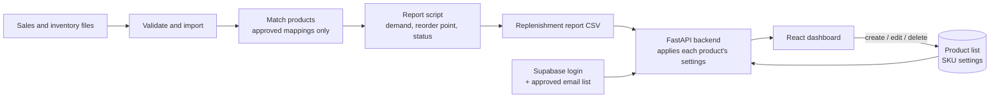

# Supply Chain Forecasting System

A prototype that brings sales and inventory data together to support replenishment planning for e-commerce Key Account Managers.

**Project status:** Working prototype, for development and testing only  
**Data:** Synthetic sample data. Not for purchasing decisions.  
**Access:** Sign-in required. Only approved team members can use the dashboard and the API.

---

## 1. Project overview

### What it is

The system takes a **sales report** and an **inventory report**, matches them product by product, and shows which products need reordering, which are fine, and which need a closer look.

### Who it is for

Key Account Managers in e-commerce, and the operations, inventory and supply chain teams who work with them. Part of a Key Account Manager's job is warning a brand early when stock is running low.

### The problem it solves

Sales and stock usually sit in separate reports and are compared by hand. That is slow, and it is easy to:

- miss a product that is about to run out, which means lost sales, or
- over-order a product that is not selling, which means money tied up in the warehouse.

This system does the matching and the calculation automatically, the same way every time, and highlights the products that need attention first.

### Objectives

- Reduce manual effort when reviewing sales and inventory reports.
- Improve visibility of product demand and available stock.
- Identify products that may need replenishment or further review.
- Keep the calculation transparent, so users can check every number.
- Restrict access to approved team members.
- Lay the foundation for an automated daily data refresh.

---

## 2. Live application

| Part | Address |
| --- | --- |
| Dashboard | https://supply-chain-forecast.pages.dev |
| Backend API | https://acommerce-supply-chain-forecast-api.onrender.com |
| API documentation | https://acommerce-supply-chain-forecast-api.onrender.com/docs |
| Health check | https://acommerce-supply-chain-forecast-api.onrender.com/health |

- The dashboard requires signing in with an approved account.
- All data endpoints require a valid login token. Only `/` and `/health` are public.
- The Render free service sleeps after inactivity. Open `/health` first and wait up to a minute for it to wake.

---

## 3. Technology stack

| Technology | Purpose |
| --- | --- |
| Python | Data processing and backend logic |
| FastAPI and Uvicorn | REST API |
| SQLAlchemy and SQLite | Database access and local database |
| Pydantic | Request and response validation |
| httpx | Verifying login tokens with Supabase |
| python-dotenv | Loading local settings from `backend/.env` |
| React and Vite | Dashboard frontend |
| Supabase Auth (`@supabase/supabase-js`) | Email and password sign-in |
| CSV and Excel | Sales, inventory, mapping and report files |
| Git and GitHub | Version control |
| Render | Backend hosting |
| Cloudflare Pages | Frontend hosting |

---

## 4. How it works



The system has four connected parts.

### A. Data processing (run by hand for now)

1. Sales and inventory files are validated for required columns and basic data quality.
2. Records are imported into the database.
3. Products are matched across the two reports using **approved** mappings only.
4. `build_replenishment_report.py` calculates demand, reorder point and status for every matched product and writes the replenishment report.

### B. Live recalculation (every time the dashboard loads)

The backend reads the report and, for each product, looks up its record in the product list by **SKU code**. It applies that product's own lead time, safety stock and active status, then recalculates the reorder point, suggested units and status. This is why a change in the product list shows up in the recommendations immediately.

### C. Product list (CRUD)

Approved users can create, read, update and delete products from the dashboard. Each product stores its planning settings (lead time and safety stock). The SKU code links a product to its row in the report.

### D. Access control

Users sign in with Supabase. The backend checks every request: the login token must be valid, **and** the email must be on the approved list.

---

## 5. Replenishment logic

### Report script steps

| Step | What the code does | Why |
| --- | --- | --- |
| 1 | Uses only mappings with status `APPROVED` | A wrong match would give one product another product's numbers |
| 2 | Counts only orders with status `COMPLETED` | Cancelled or returned orders are not real demand |
| 3 | Uses the 14 days ending on the latest sale date in the data | Reflects current demand and still works if the data is a few days old |
| 4 | Sums units sold per product in that window | Units sold recently |
| 5 | Average daily demand = units sold ÷ 14 | Days with no sales still count |
| 6 | Takes the latest stock snapshot per product | Reordering depends on current stock |
| 7 | Flags products with two or more snapshots on the latest date | Avoids picking a stock figure at random |
| 8 | Reorder point = average daily demand × (lead time + safety stock days) | Stock needed until new stock arrives, plus a buffer |
| 9 | Suggested units = reorder point − current stock, never below zero | Shows the shortfall |
| 10 | Writes the recommendations and a list of unmatched sales | Nothing is silently dropped |

### How each status is decided

Rules are checked in order; the first one that applies is used.

1. No usable stock record → `REVIEW INVENTORY DATA`
2. Two or more stock records on the latest date → `REVIEW: ambiguous latest snapshot`
3. Slow-moving product with no sales → `SLOW-MOVING: review longer demand history`
4. No completed sales in the window → `REVIEW: no completed demand in window`
5. Stock at or below the reorder point → `REPLENISHMENT REVIEW`
6. Otherwise → `Stock above provisional reorder point`

Data problems are checked first, because a calculation on unreliable data is not useful. Zero sales is flagged rather than treated as "no need to order", since the product may have been out of stock.

### Why the settings are set this way

| Setting | Default | Reasoning |
| --- | --- | --- |
| Demand window | 14 days | Smooths daily variation and covers two full weekly cycles, while staying recent |
| Lead time | 7 days, editable per product | Starting assumption for reorder-to-arrival time; suppliers differ |
| Safety stock | 3 days, editable per product | Buffer for demand spikes or late deliveries; in days, so it scales with each product's sales |
| Suggested units | Rounded up | Units cannot be ordered in fractions |
| Products not in the product list | Use the defaults | Every report row still gets a sensible result |

### Worked example

Wi-Fi LED Strip: 7 units sold in 14 days.

- Average daily demand: 7 ÷ 14 = **0.5** units per day
- Reorder point with defaults: 0.5 × (7 + 3) = **5** units
- Latest stock: 35, which is above 5, so suggested units = **0**

If its lead time is changed to 80 days in the product list:

- Reorder point: 0.5 × (80 + 3) = **41.5** units
- Suggested units: 41.5 − 35 = 6.5, rounded up to **7**
- Status: `REPLENISHMENT REVIEW`

### Live recalculation rules (`main.py`)

- Inactive products are shown as `INACTIVE: excluded from replenishment`, with no suggestion.
- Only the two normal statuses (`REPLENISHMENT REVIEW` and `Stock above provisional reorder point`) are recalculated. Review flags from the script are kept, because changing a setting cannot fix a data problem.

These calculations are illustrative and must be validated against real business requirements before any operational use.

---

## 6. Dashboard design

The page reads from top to bottom: **summary, detail, action**.

| Part | Purpose |
| --- | --- |
| Sign-in screen | Restricts access to approved team members |
| Synthetic data banner | Prevents test numbers being mistaken for real advice |
| Summary cards | Show at a glance how many products need reordering |
| Assumptions strip | Keeps the demand window and default settings visible |
| Recommendations table | Columns follow the calculation left to right, so every number can be checked |
| Status colours and notes | Green = fine, amber = review, purple = slow-moving, grey = inactive; the note explains why |
| Product list | On the same page, so the effect of a change is visible immediately |

---

## 7. Repository structure

```text
supply-chain-forecast/
├── backend/
│   ├── main.py                        # API, login check, live recalculation, CRUD
│   ├── database.py                    # Database connection
│   ├── models.py                      # Database tables
│   ├── schemas.py                     # Request and response validation
│   ├── requirements.txt
│   ├── .env.example                   # Template for local settings (copy to .env)
│   ├── validate_reports.py
│   ├── import_reports.py
│   ├── import_product_mappings.py
│   ├── data_quality_checks.py
│   ├── build_demand_report.py
│   ├── build_replenishment_report.py  # Main replenishment logic
│   ├── build_baseline_forecast.py
│   ├── evaluate_baseline_forecast.py
│   └── update_schema.py
├── frontend/
│   └── src/
│       ├── App.jsx                    # Dashboard, sign-in flow, API calls
│       ├── Login.jsx                  # Sign-in screen
│       ├── ProductManager.jsx         # Product list (CRUD)
│       ├── supabaseClient.js          # Supabase connection
│       └── App.css
├── data/
│   ├── incoming/
│   └── product_mapping_review.csv
├── reports/
└── README.md
```

---

## 8. Data inputs and outputs

### Input files (synthetic)

- `data/incoming/Inventory_Report_SYNTHETIC.csv`
- `data/incoming/Sales_QTY_Breakdown_SYNTHETIC.xlsx`
- `data/product_mapping_review.csv`

### Generated reports

- `reports/replenishment_recommendations_SYNTHETIC.csv`, read by the API
- `reports/unmatched_replenishment_products_SYNTHETIC.csv`
- `reports/unmatched_completed_sales_SYNTHETIC.csv`
- `reports/demand_stock_coverage_SYNTHETIC.csv`
- `reports/data_quality_report_SYNTHETIC.csv`
- `reports/baseline_forecast_SYNTHETIC.csv`
- `reports/baseline_forecast_evaluation_SYNTHETIC.csv`

---

## 9. API endpoints

| Method | Endpoint | Purpose | Login required |
| --- | --- | --- | --- |
| GET | `/` | Root message | No |
| GET | `/health` | Health check | No |
| GET | `/me` | Returns the signed-in user's email | Yes |
| GET | `/replenishment` | Report recalculated with product settings | Yes |
| GET | `/skus` | List products | Yes |
| POST | `/skus` | Create a product | Yes |
| POST | `/skus/sync-from-report` | Add report products missing from the product list | Yes |
| GET | `/skus/{sku_id}` | Get one product by database ID | Yes |
| PATCH | `/skus/{sku_id}` | Update selected fields | Yes |
| DELETE | `/skus/{sku_id}` | Delete a product | Yes |

Protected endpoints expect the header `Authorization: Bearer <token>`. In `/docs`, use the **Authorize** button.

`/skus/{sku_id}` uses the **database ID** (for example `8`), not the SKU code (for example `929004100103`).

### Response codes

| Code | Meaning |
| --- | --- |
| 200 | Success |
| 201 | Created |
| 400 | No fields provided for update |
| 401 | Not signed in, or the session has expired |
| 403 | Signed in, but the email is not on the approved list |
| 404 | Record or report not found |
| 409 | SKU code already exists |
| 422 | Invalid input, for example a blank SKU code or negative days |
| 503 | The login service could not be reached |

---

## 10. Access control

### How it works

1. Users sign in with email and password through Supabase.
2. The website sends the login token with every API request.
3. The backend asks Supabase whether the token is valid and whose it is (otherwise **401**).
4. The backend checks the email against `ALLOWED_EMAILS` (otherwise **403**).

If `ALLOWED_EMAILS` is empty, nobody can access the data. This is the safe default.

### Supabase setup

1. Create a Supabase project.
2. **Authentication → Sign In / Providers:** enable Email, and turn **off** "Allow new users to sign up".
3. **Authentication → Users → Add user → Create new user:** add each approved person and tick **Auto Confirm User**.
4. **Project Settings → Data API:** copy the Project URL (without `/rest/v1/`).
5. **Project Settings → API Keys:** copy the **publishable** key.
6. **Authentication → URL Configuration:** set Site URL to the production dashboard address.

Never use the **secret** or `service_role` key in this project, and never put it in a `VITE_` variable.

### Managing access

- **Add a user:** create the account in Supabase **and** add the email to `ALLOWED_EMAILS` on Render.
- **Remove a user:** remove the email from `ALLOWED_EMAILS` on Render (effective after redeploy), then delete the account in Supabase.

---

## 11. Local development

### Prerequisites

Python, Node.js and npm, Git, and a code editor such as Visual Studio Code.

### 1. Clone the repository

```bash
git clone https://github.com/utunalam/supply-chain-forecast.git
cd supply-chain-forecast
```

### 2. Backend setup (PowerShell)

```powershell
cd backend
python -m venv .venv
.\.venv\Scripts\python.exe -m pip install -r requirements.txt
Copy-Item .env.example .env
notepad .env
```

Fill in `backend/.env`:

```text
SUPABASE_URL=https://YOUR-PROJECT.supabase.co
SUPABASE_ANON_KEY=your-publishable-key
ALLOWED_EMAILS=you@example.com,colleague@example.com
FRONTEND_ORIGIN=http://localhost:5173
```

Start the backend from the `backend` folder:

```powershell
.\.venv\Scripts\python.exe -m uvicorn main:app --reload --host 127.0.0.1 --port 8000
```

### 3. Frontend setup

In a second terminal:

```powershell
cd frontend
npm ci
```

Create `frontend/.env`:

```text
VITE_API_URL=http://127.0.0.1:8000
VITE_SUPABASE_URL=https://YOUR-PROJECT.supabase.co
VITE_SUPABASE_ANON_KEY=your-publishable-key
```

Start the frontend:

```powershell
npm run dev
```

Open http://localhost:5173 and sign in with an approved account.

Both `.env` files are ignored by Git. Check with `git check-ignore backend/.env frontend/.env`.

### Troubleshooting

| Problem | Fix |
| --- | --- |
| `Could not import module "main"` | Start uvicorn from the `backend` folder |
| `No module named ...` | Use the project's own Python: `.\.venv\Scripts\python.exe` |
| "Could not reach the server" after signing in | Check `backend/.env` exists and restart the backend |
| Changes to `.env` have no effect | Restart the backend or `npm run dev`; settings are read at start-up |
| An old backend keeps answering on port 8000 (Windows) | `Get-Process python* \| Stop-Process -Force`, then start again |
| "Not authorised" | The email is not in `ALLOWED_EMAILS` |
| "Failed to fetch" | Backend not running, or the browser address is not in `FRONTEND_ORIGIN` |

---

## 12. Data validation and report generation

From the project root:

```powershell
.\backend\.venv\Scripts\python.exe .\backend\validate_reports.py
.\backend\.venv\Scripts\python.exe .\backend\import_reports.py
.\backend\.venv\Scripts\python.exe .\backend\data_quality_checks.py
.\backend\.venv\Scripts\python.exe .\backend\build_demand_report.py
.\backend\.venv\Scripts\python.exe .\backend\build_replenishment_report.py
```

Run validation and resolve data-quality issues before publishing updated reports.

**Important:** the importer is not yet safe for repeated daily use. Its handling of previously imported records and repeated source filenames can cause new records to be skipped or inventory history to be overwritten.

---

## 13. Deployment

### Backend: Render

| Setting | Value |
| --- | --- |
| Repository | `utunalam/supply-chain-forecast` |
| Branch | `master` |
| Build command | `pip install -r backend/requirements.txt` |
| Start command | `uvicorn main:app --app-dir backend --host 0.0.0.0 --port $PORT` |

Environment variables:

| Name | Value |
| --- | --- |
| `SUPABASE_URL` | Supabase project URL |
| `SUPABASE_ANON_KEY` | Supabase publishable key |
| `ALLOWED_EMAILS` | Approved emails, comma-separated |
| `FRONTEND_ORIGIN` | `https://supply-chain-forecast.pages.dev` (exact, no trailing slash) |

On start-up, the backend creates its tables and, if the product list is empty, fills it from the report. The free Render filesystem is temporary, so product edits are lost when the service restarts.

### Frontend: Cloudflare Pages

| Setting | Value |
| --- | --- |
| Branch | `master` |
| Root directory | `frontend` |
| Build command | `npm run build` |
| Output directory | `dist` |

Production environment variables:

| Name | Value |
| --- | --- |
| `VITE_API_URL` | `https://acommerce-supply-chain-forecast-api.onrender.com` |
| `VITE_SUPABASE_URL` | Supabase project URL |
| `VITE_SUPABASE_ANON_KEY` | Supabase publishable key |

`VITE_` values are built into the website and visible to visitors, so only public values belong here. Changing them requires a new build.

### Verification after deployment

1. `/health` returns `{"status":"healthy"}`.
2. `/replenishment` opened directly returns `{"detail":"Please sign in."}`.
3. The dashboard shows the sign-in screen.
4. An approved account reaches the dashboard; an unapproved account sees "Not authorised".
5. Editing a product's lead time changes its reorder point in the table.

---

## 14. Current limitations

- Synthetic data only; the logic has not been tested against real sales.
- New sales and stock data are loaded by running the scripts by hand.
- The importer is not yet safe for repeated daily runs.
- The free Render database resets on restart; product edits are not permanent.
- New products only receive a recommendation once their sales and stock exist in the report.
- Several stock rows on the same date (for example batches) are flagged rather than added together.
- One stock item matched to several sales listings produces separate rows, so demand may be split.
- The 14-day average does not account for trends, seasonality or promotions.
- The approved user list is managed by hand through an environment variable.
- Not benchmarked for large numbers of products.

---

## 15. Improvement pipeline

1. **Safe daily import:** identify new records reliably and avoid duplicates or overwrites.
2. **Automatic daily refresh:** a scheduled job loads new files, validates them and rebuilds the report.
3. **Permanent database:** move from the temporary SQLite file to a persistent database such as Supabase PostgreSQL.
4. **Real order quantity:** include stock already on order, minimum order quantities and case packs.
5. **Combine listings and batches:** aggregate demand across listings and stock across batches.
6. **Alerts:** notify users when a product reaches its reorder point.
7. **Better forecasting:** test methods that capture trends and seasonality, and keep them only if they beat the 14-day baseline on real data.
8. **Roles and audit log:** separate view-only and edit access, and record who changed what.
9. **Measure impact:** track forecast error, stockout frequency, excess inventory and time saved.

---

## 16. Learning outcomes

- Python data processing and rule-based decision logic
- REST API design, CRUD and input validation
- Database modelling with SQLAlchemy
- Authentication and authorisation with Supabase and FastAPI
- React frontend and backend communication
- Git, GitHub and deployment with Render and Cloudflare Pages
- Debugging, testing and documenting a multi-part application

---

## 17. Disclaimer

This project is for learning, demonstration and development purposes. All sample data and recommendations are synthetic and must not be used for actual purchasing, replenishment or other operational decisions. Further data validation, automation, security review and forecast evaluation are required before production use.
